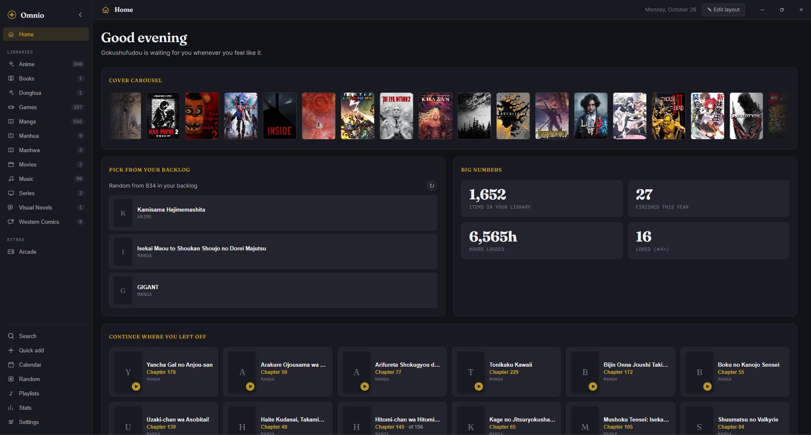
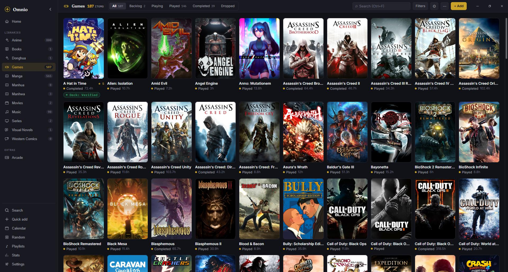
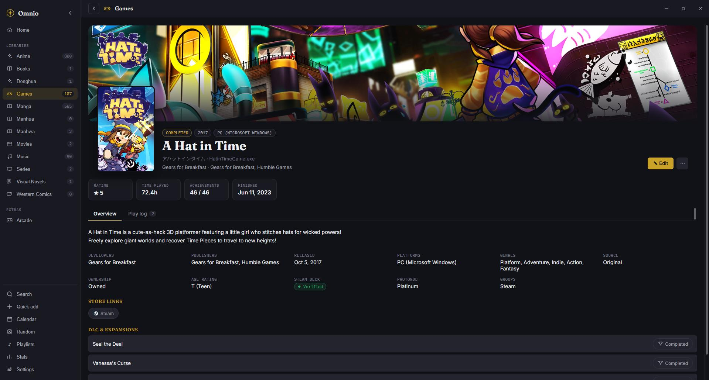
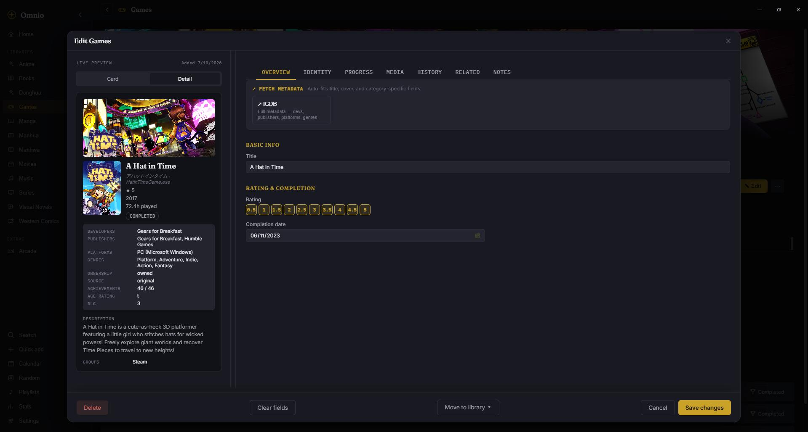
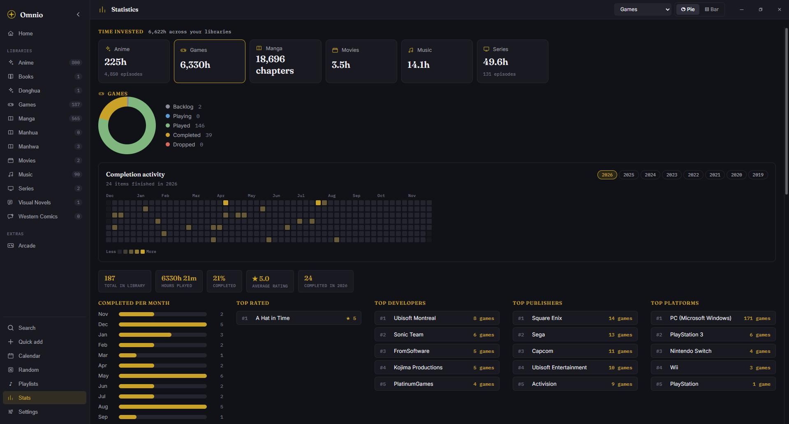

<div align="center">


# Omnio

**English** · [Español](README.es.md)

**Every hobby you track, in one app that lives on your computer.**

Games · Music · Movies · Series · Anime · Donghua · Manga · Manhwa · Manhua · Comics · Books · Visual Novels

[](https://github.com/TonyMontania/Omnio/releases/latest)

[](https://github.com/TonyMontania/Omnio/releases/latest)
[](https://github.com/TonyMontania/Omnio/releases/latest)
[](https://github.com/TonyMontania/Omnio/releases)
[](https://github.com/TonyMontania/Omnio/actions/workflows/test.yml)
[](LICENSE)


[](https://tauri.app/)
[](https://github.com/TonyMontania/Omnio/stargazers)

</div>

- **12 libraries, one app** — stop juggling a site per hobby.
- **One-click metadata from 14 sources** — covers, descriptions, tracklists, cast, tags.
- **Yours, offline** — no accounts, no cloud, no telemetry. Your library is a folder of JSON files you own.

https://github.com/user-attachments/assets/82b0c326-aa91-4cf0-a5a1-38c2cf101782

## Contents

- [Install](#install)
- [See it in action](#see-it-in-action)
- [Why Omnio?](#why-omnio)
- [Features](#features)
- [Metadata sources](#metadata-sources)
- [Storage](#storage)
- [Keyboard shortcuts](#keyboard-shortcuts)
- [Privacy](#privacy)
- [Credits](#credits)
- [License](#license)

## Install

| OS | Quickest way |
| --- | --- |
| **Windows** | [`-setup.exe` installer](https://github.com/TonyMontania/Omnio/releases/latest) — or the portable `.zip` |
| **macOS** | [`.dmg`](https://github.com/TonyMontania/Omnio/releases/latest) — `aarch64` for Apple Silicon, `x64` for Intel |
| **Linux** | [`.AppImage`](https://github.com/TonyMontania/Omnio/releases/latest), `.deb` or `.rpm` |

Builds are unsigned, so Windows SmartScreen and macOS Gatekeeper show a one-time warning on first launch. Details for every package are below.

<details>
<summary><b>Windows — all packages</b></summary>

| Package | File | Command | Notes |
| --- | --- | --- | --- |
| **NSIS installer** | `Omnio_<version>_x64-setup.exe` | double-click | Per-user, no admin. Recommended default. |
| **MSI installer** | `Omnio_<version>_x64_en-US.msi` | `msiexec /i Omnio_<version>_x64_en-US.msi /qb` | For group-policy / SCCM / Intune rollouts. |
| **Portable ZIP** | `Omnio_<version>_windows-portable.zip` | extract, run `omnio.exe` | Windows 10 21H2+ and every Windows 11 already have WebView2. On older builds install the [Evergreen runtime](https://developer.microsoft.com/microsoft-edge/webview2/) once; otherwise `omnio.exe` closes immediately with no window. |
| **winget** | — | `winget install TonyMontania.Omnio` | Ships the NSIS build. Available once the manifest lands in [`microsoft/winget-pkgs`](https://github.com/microsoft/winget-pkgs). |

Data lives under `%APPDATA%\com.omnio.app\` (the portable build keeps it next to `omnio.exe`).

</details>

<details>
<summary><b>macOS — all packages</b></summary>

| Package | File | Command | Notes |
| --- | --- | --- | --- |
| **DMG (Apple Silicon)** | `Omnio_<version>_aarch64.dmg` | drag to Applications | For M1 / M2 / M3 / M4 Macs. |
| **DMG (Intel)** | `Omnio_<version>_x64.dmg` | drag to Applications | For pre-Apple-Silicon Macs. |

First launch on macOS 14 Sonoma or earlier: right-click **Open** → **Open**. On macOS 15 Sequoia the right-click bypass is gone, so run once from the Terminal:

```bash
xattr -cr /Applications/Omnio.app
open /Applications/Omnio.app
```

The `xattr -cr` clears the quarantine flag Gatekeeper set on the download. Same command works on older macOS if you'd rather skip the right-click flow.

Data lives under `~/Library/Application Support/com.omnio.app/`.

</details>

<details>
<summary><b>Linux — all packages</b></summary>

| Package | File | Command | Notes |
| --- | --- | --- | --- |
| **AppImage** | `omnio_<version>_amd64.AppImage` | `chmod +x omnio_<version>_amd64.AppImage && ./omnio_<version>_amd64.AppImage` | Universal. Debian / Ubuntu 22.04+ need `libfuse2` (`sudo apt install libfuse2`). No FUSE? Run with `./omnio_<version>_amd64.AppImage --appimage-extract-and-run`. |
| **Debian package** | `omnio_<version>_amd64.deb` | `sudo dpkg -i omnio_<version>_amd64.deb` | Debian, Ubuntu, Mint, Pop!_OS, elementary. |
| **RPM package** | `omnio-<version>-1.x86_64.rpm` | `sudo dnf install ./omnio-<version>-1.x86_64.rpm` | Fedora, RHEL, CentOS Stream, Rocky, Alma, openSUSE. |
| **AUR** | — | `yay -S omnio-bin` (or your AUR helper) | Arch, Manjaro, EndeavourOS. Repackages the upstream `.deb`. Coming soon. |

Data lives under `~/.local/share/com.omnio.app/`.

</details>

Building from source? See [CONTRIBUTING.md → Running locally](CONTRIBUTING.md#running-locally).

## See it in action


*Home: a board of widgets you can drag, resize and rearrange: what you're in the middle of, a cover carousel, big numbers, something to pick from your backlog and more.*


*Library: cover-first browsing with status filters, search, sorting, grouping and bulk actions.*


*Detail page: banner, cover, your stats at a glance and everything the metadata sources filled in.*


*Editor: tabs for every part of an item, a live preview of the card and the detail page, and one-click metadata from 14 sources.*


*Statistics: time invested per library, status breakdown, completion activity and your top developers, publishers and platforms.*

## Why Omnio?

| | Tracking websites | Spreadsheets | **Omnio** |
| --- | :---: | :---: | :---: |
| Every hobby in one place | One site per hobby | ✓ | ✓ |
| Covers and metadata filled for you | ✓ | — | ✓ |
| Works offline | — | ✓ | ✓ |
| No account needed | — | ✓ | ✓ |
| Your data stays on your disk | — | ✓ | ✓ |
| Import from MAL, AniList, Steam, Letterboxd, Goodreads… | Partly | — | ✓ |
| Free and open source | Varies | — | ✓ |

## Features

<table>
<tr>
<td width="33%" valign="top">

**Track**

- **12 libraries** — Games · Music · Movies · Series · Anime · Donghua · Manga · Manhwa · Manhua · Western Comics · Books · Visual Novels
- **Tabbed editor** (Overview / Identity / Progress / Media / History / Related / Notes) with a live card + detail preview
- **Views** — grid, list, compact, Kanban by status, release-year timeline and a diary of what you added and finished
- **Custom fields** per library, shown in the editor and optionally as a chip on the card
- **Bulk actions** — multi-select cards to change status, rating, tags, groups or move between libraries
- **Tag hierarchy** — nest tags (`jrpg → turn-based`); filtering a parent matches every descendant
- **Half-star ratings** in 0.5 steps
- **Item templates** — save the defaults you want prefilled per category
- **Playlists** — ordered lists that mix items from every library

</td>
<td width="33%" valign="top">

**Discover**

- **One-click metadata + covers** from 14 sources (see below). Cached locally for 24 h
- **Quick add** from the sidebar, or paste an IGDB / TMDb / AniList / VNDB / Steam URL into the title field, the fetcher opens pre-filled
- **Global search (Ctrl+K)** across every library with operator syntax (`favorite:true`, `year:>2020`, `status:playing`)
- **Home widget board** — Continue where you left off, Currently airing, Upcoming this week, Cover carousel, Big numbers, On this day, Rating spread, Top of the year, Genre spotlight, Pick from your backlog and more. Drag & drop, resize, and quick-add from the sidebar
- **Release calendar** — upcoming releases and airing dates, exportable to iCal
- **Random picker** — let Omnio choose the next thing from your backlog
- **Franchise timeline** across libraries, by sections or as a free-form diagram
- **Statistics view** — per-category distribution + activity heatmap, cross-library genre matrix, monthly added-vs-finished chart, top rated / artists / genres / labels / devs / publishers / platforms
- **Arcade section** — score / 1cc tracker for shmups and arcade games. Grid mode adapted from [doopu/1ccTracker](https://github.com/doopu/1ccTracker)

</td>
<td width="33%" valign="top">

**Own your data**

- **Fully local** — no accounts, no telemetry, no analytics
- **Import** — MAL / AniList XML, Steam, Letterboxd, IMDb, Backloggd, Serializd, Spotify, RateYourMusic, Kindle highlights, Last.fm (CSV + API sync), local music folder scan, Trakt.tv, Discogs, StoryGraph, installed Steam / GOG / Epic games, Excel / CSV / Notion / TXT (Playnite, GOG and Goodreads exports are recognized automatically)
- **Export** — static HTML site (searchable, light/dark), MAL XML, iCal for release calendar, per-category CSV, Yearly Wrapped PNG
- **Rolling backups** — 5 automatic snapshots per save, restore any of them; optional scheduled copy to a folder (Dropbox, OneDrive…)
- **Clean-up tools** — find duplicates, merge genre and role variants, audit missing fields, fix broken covers, check a music artist's discography for missing albums
- **In-app updater** — checks GitHub Releases, downloads the matching build
- **HTTP proxy** support for every outbound request
- **11 themes × 8 accents** — Dark / Light / AMOLED / Nord / Tokyo Night / Solarized / Dracula / Catppuccin / Rosé Pine / Gruvbox / Everforest

</td>
</tr>
</table>

## Metadata sources

Click the **↗** button on the "Fetch metadata" panel to search, pick and auto-fill. API keys (only for the sources that require them) go in **Settings → Integrations**. Full field-coverage matrix in [`docs/FETCHER_FIELDS.md`](docs/FETCHER_FIELDS.md).

Sources are grouped by the library they feed. Anything marked *No key* works out of the box.

**Games**

| Source | What it fills | Auth |
| --- | --- | --- |
| [IGDB](https://www.igdb.com/) | Full metadata + source inference (Remake / Remaster / Port…) | Twitch Client ID + Secret (free) |
| [SteamGridDB](https://www.steamgriddb.com/) | Covers, banners, logos, heroes | Free API key |
| [PCGamingWiki](https://www.pcgamingwiki.com/) | Save + config paths per OS | No key |

**Movies & Series**

| Source | What it fills | Auth |
| --- | --- | --- |
| [TMDb](https://www.themoviedb.org/) | Titles, cast, crew, backdrops, runtime, seasons + episodes | Free API key |

**Anime & Donghua**

| Source | What it fills | Auth |
| --- | --- | --- |
| [AniList](https://anilist.co/) | Full metadata, tags, relations | No key |
| [AniDB](https://anidb.net/) | Weighted tags, tighter cross-refs (paste AID) | Registered client name |
| [Kitsu](https://kitsu.app/) | Age rating fallback that AniList lacks | No key |

**Manga · Manhwa · Manhua · Western Comics**

| Source | What it fills | Auth |
| --- | --- | --- |
| [AniList](https://anilist.co/) | Full metadata for manga family | No key |
| [MangaDex](https://mangadex.org/) | Full metadata + MangaDex ID for "new chapters" deep link | No key |
| [Kitsu](https://kitsu.app/) | Manga fallback | No key |
| [ComicVine](https://comicvine.gamespot.com/) | Western Comics (Marvel, DC, Image, indies) | Free API key |

**Music**

| Source | What it fills | Auth |
| --- | --- | --- |
| [MusicBrainz](https://musicbrainz.org/) + [Cover Art Archive](https://coverartarchive.org/) | Title, artist, tracklist, producers, cover art, per-edition picker | No key |
| [lrclib](https://lrclib.net/) | Per-track lyrics (synced when available) | No key |
| [Last.fm](https://www.last.fm/) | Sync your top-scrobbled albums (marks matches as listened) | Free API key + username |

**Books**

| Source | What it fills | Auth |
| --- | --- | --- |
| [OpenLibrary](https://openlibrary.org/) | Title, authors, description, publisher, ISBN, cover | No key |

**Visual Novels**

| Source | What it fills | Auth |
| --- | --- | --- |
| [VNDB](https://vndb.org/) | Description, aliases, engine, tags, screenshots, characters + staff, multi-region covers, relations | No key |

## Storage

Your library lives in two folders under the OS's app data directory (or next to the executable for portable builds):

```
data/
  games.json  music.json  movies.json  series.json
  anime.json  donghua.json
  manga.json  manhwa.json  manhua.json  comics_west.json
  books.json  visual_novels.json
  collections.json  artists.json  arcadeGames.json
  smartLists.json  playlists.json
  settings.json  customOrders.json
  cache/searches.json    ← 24 h TTL of metadata search results
  backups/1..5/          ← 5 rotating snapshots
assets/
  <category>/<kind>/<filename>
  games/saves/<title>/…      ← per-game save files
  games/screenshots/<title>/…
```

Each library is its own JSON — editing one game only rewrites `games.json`, so corruption of one file leaves the rest intact. Asset filenames use the item's title (`Hollow Knight cover.jpg`) so browsing `assets/` in Explorer / Finder stays meaningful.

## Keyboard shortcuts

- **Ctrl+K** — global search across every library
- **Ctrl+F** — search inside the current library
- **Ctrl+Z / Ctrl+Shift+Z** (or **Ctrl+Y**) — undo / redo
- **Ctrl+H** — go to Home
- **F5** — reload data from disk
- **?** — full shortcut cheatsheet
- **Right-click** — quick actions on any card
- **Shift+click** — multi-select
- **Esc** — close modal / panel

Every shortcut can be changed or turned off in **Settings → Keyboard shortcuts**.

## Privacy

- **No accounts, no telemetry, no analytics.** Nothing is sent home.
- **Outbound requests only when you trigger them** — metadata lookups (one request per search you run) and the update check against GitHub Releases at startup.
- **API keys** you paste into Settings → Integrations live in `data/settings.json` on your disk and are only used to sign that source's requests.
- **No third-party trackers** in the app or in the exported HTML site.

## Credits

- **Arcade → Grid mode** is a reimplementation of [doopu/1ccTracker](https://github.com/doopu/1ccTracker) — same visual language and per-cell flag vocabulary (1cc / no-miss / no-bomb / pacifist / all-clear / extra-clear), integrated into Omnio's data model.

## License

[MIT](LICENSE) — feel free to fork, modify and distribute.

---

<div align="center">

**If Omnio is useful to you, a ⭐ on the repo helps other people find it.**

</div>

- Bugs / feature requests → [issues](https://github.com/TonyMontania/Omnio/issues)
- Want to contribute? → [CONTRIBUTING.md](CONTRIBUTING.md) · [CODE_OF_CONDUCT.md](CODE_OF_CONDUCT.md)
- Security → [SECURITY.md](SECURITY.md)
- Full field-by-field reference → [`docs/FIELDS.md`](docs/FIELDS.md)
- Changelog → [CHANGELOG.md](CHANGELOG.md) · [releases page](https://github.com/TonyMontania/Omnio/releases)
